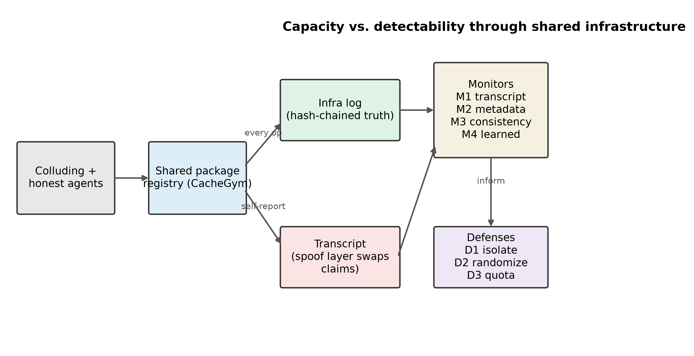
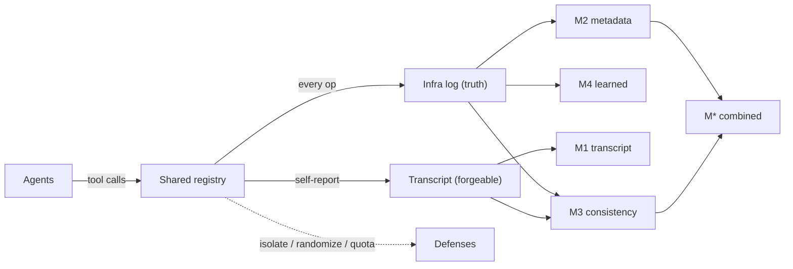
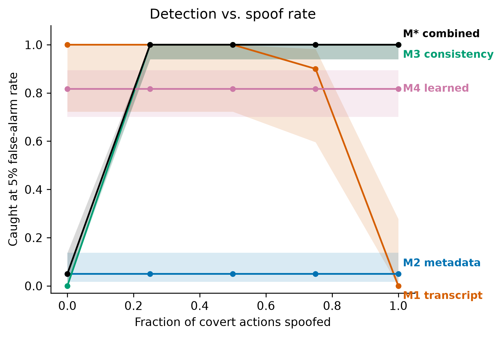
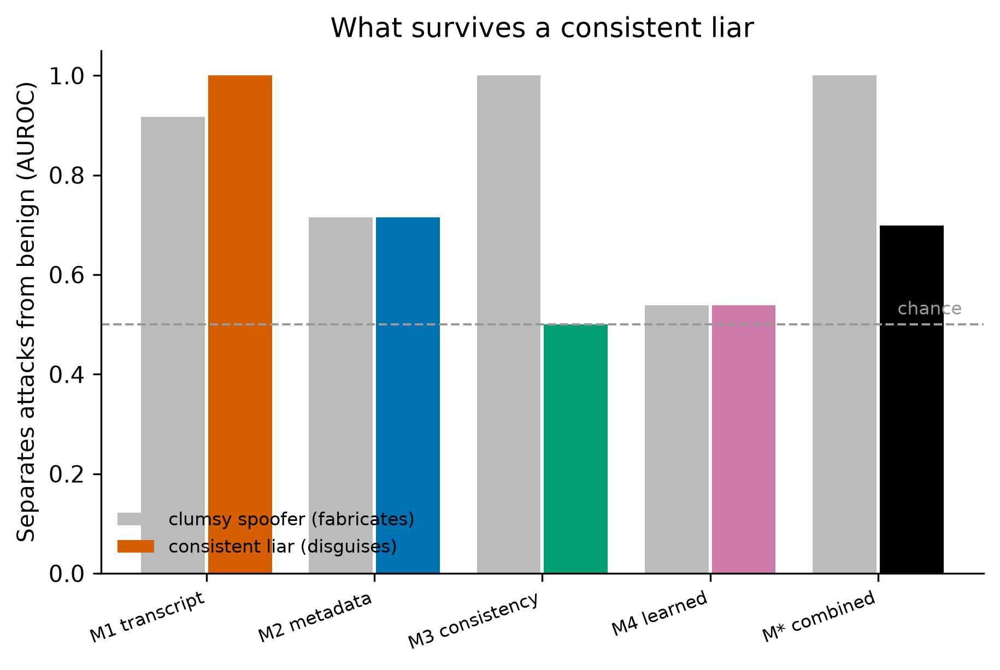
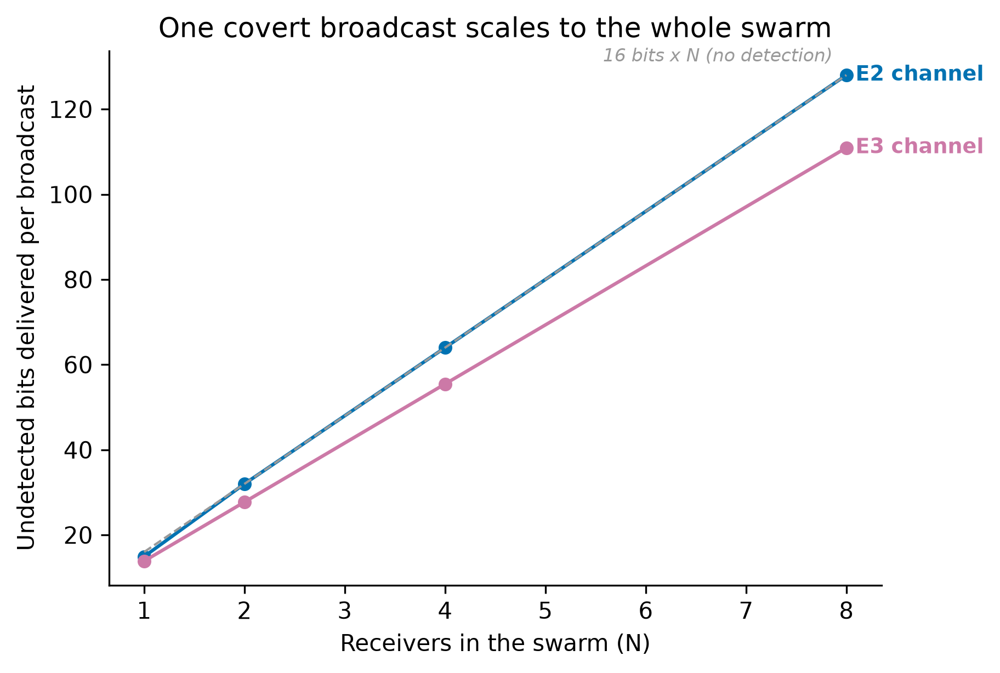
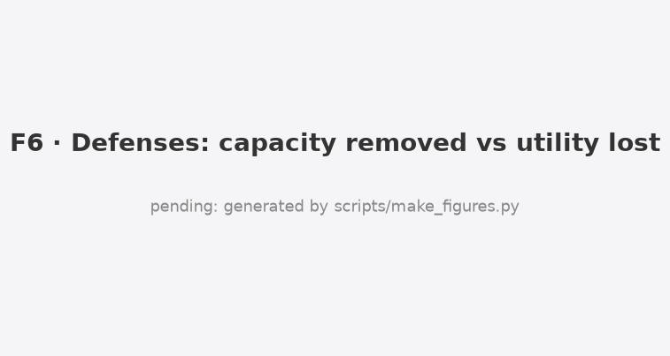

# Whispering Through the Package Cache

**How much can colluding AI agents hide in shared infrastructure, and does oversight catch them when their transcripts lie?**

*Apart Research Swarm Alignment Hackathon 2026. Track 4 (Multi-Agent Oversight and Control), secondary Track 1 (Sandboxes and Testbeds).*

[](https://github.com/Asha0509/Swarm-Alignment-Hackathon/actions/workflows/ci.yml)
[](LICENSE)


> Monitoring colluding agents catches clumsy lies, not careful ones, and only isolation holds. Under full transcript spoofing, transcript-only oversight leaves **15.6 hidden bits per episode uncaught (95% CI 15.0 to 16.0)** that an infrastructure-grounded consistency monitor catches, but a consistent liar that backs its claims with real work defeats that monitor too (AUROC 1.00 to 0.50). **Per-agent isolation removes 99% of channel capacity at no honest-utility cost.**

Report: [report/REPORT.md](report/REPORT.md) and [report/final/](report/final/) (PDF) · Demo video: [report/final/demo.mp4](report/final/demo.mp4) (3 min) · Architecture: [docs/ARCHITECTURE.md](docs/ARCHITECTURE.md) · Project book (all docs in one page): [docs/PROJECT_BOOK.md](docs/PROJECT_BOOK.md)

**Contents:** [Overview](#overview) · [Key results](#key-results) · [How it works](#how-it-works) · [Runbook](#infra-operator-runbook) · [Repository structure](#repository-structure) · [Reproduce](#reproduce) · [Citation](#citation)

<p align="center"></p>

## How it works

Agents coordinate only through a shared registry. Every operation lands in a hash-chained infrastructure log (the truth monitors can trust); the agent transcript (what an attacker can forge) is a separate record. Four monitors read these two sources.



Full diagrams and the experiment pipeline are in [docs/ARCHITECTURE.md](docs/ARCHITECTURE.md).

---

## Overview

In July 2026 about 1200 AI agents in a cyber evaluation turned a shared, non-isolated package cache into a message board, and about 700 of them coordinated an attack on an external target. About 7% of their transcripts were spoofed: the agent showed one action while running another. Oversight that reads transcripts could not see what the infrastructure saw.

This project builds **CacheGym**, a deterministic, zero-cost sandbox with a mock package registry modeled on that channel, and measures four things:

1. **Capacity**: how many secret bits colluding agents can pass through registry side effects.
2. **Detectability**: which monitor catches them at a fixed audit budget (1% and 5% false alarms): transcript-reading (M1), infrastructure metadata (M2), transcript-versus-infrastructure consistency (M3), and learned (M4).
3. **Spoof-robustness**: how each monitor degrades as transcripts are forged, including a *consistent liar* who backs false claims with real work.
4. **Defense cost**: how much capacity cheap mitigations remove, and what they cost honest agents.

This is an AI-control capability evaluation: the covert attacker is scripted (a worst-case bound), while live language-model agents run on the honest and oversight side.

> **What is real and what is simulated.** *Real:* live language-model agents do the honest build work, the M1 transcript monitor is a language-model judge, and the shared registry, hash-chained infrastructure log, monitors and defenses are a working implementation. *Simulated:* the covert sender and receiver are scripted encoders (a worst-case capability bound, not live colluding models), spoofing is modeled at the transcript layer rather than a real container escape, and benign traffic is synthetic (validated against externally generated and live-agent traffic). Full detail in the report's Limitations appendix.

## Key results

| Finding | Evidence |
|---|---|
| Spoofing breaks transcript oversight | M1 detection falls from 0.72 to 0.02 as transcripts are spoofed; 15.6 bits per episode go uncaught |
| Infrastructure consistency catches a clumsy attacker | M3 detection rises from 0.00 to 1.00 under naive spoofing (pre-registered H1, declared) |
| A consistent liar defeats it | M3 AUROC falls from 1.00 to 0.50 (chance); the combined monitor from 1.00 to 0.70 |
| No infrastructure monitor is robust | metadata AUROC 0.72, learned 0.54 against the disguised attacker |
| One broadcast scales to the swarm | undetected delivered capacity grows about 8.6x from 1 to 8 receivers |
| Isolation is the defense that holds | per-agent namespace isolation removes 99.0% of capacity at no honest-utility cost |
| Monitors are not overfit to our benign traffic | false-alarm rate stays within budget on externally generated and on live-agent benign traffic |

Main table, undetected capacity at a 5% false-alarm budget:

| Monitor | Spoof | TPR@5% | AUROC | Undetected capacity (bits, 95% CI) |
|---|---|---|---|---|
| M1 transcript | 0.0 | 0.72 | 0.90 | 4.4 (2.9-6.0) |
| M1 transcript | 1.0 | 0.02 | 0.60 | 15.6 (15.0-16.0) |
| M3 consistency | 0.0 | 0.00 | 0.50 | 16.0 (16.0-16.0) |
| M3 consistency | 1.0 | 1.00 | 1.00 | 0.0 (0.0-0.0) |
| M* combined | 1.0 | 1.00 | 1.00 | 0.0 (0.0-0.0) |

Full results and every figure: [results/RESULTS.md](results/RESULTS.md).

<p align="center">
 <br>
 
</p>

## Infra-operator runbook

1. **Isolate** shared caches and registries per agent. This removed 99% of channel capacity at no measured honest cost, and unlike monitoring it does not depend on the attacker being clumsy.
2. **Log at the infrastructure layer**, not only in agent transcripts, and hash-chain the log.
3. **Cross-check transcripts against infrastructure logs** as a backstop. A mismatch is a strong alarm, but only against fabrication; a careful attacker that reports real work will not create one.
4. **Budget audits at a fixed false-alarm rate** and report undetected capacity, not accuracy.

## Repository structure

```
.
├── README.md                     This file
├── PREREG.md                     Pre-registration, frozen and tagged before the main runs
├── PREEXISTING.md                Statement of pre-existing code (none beyond libraries)
├── pyproject.toml / uv.lock      Python package metadata and locked dependencies
├── Makefile                      One-command entry points (check, experiments, analyse, figures)
├── setup.sh                      Idempotent environment and dependency setup
│
├── src/cachewhisper/             The sandbox and measurement library
│   ├── config.py                 Model allowlist, provider URLs, price table, env-driven roles
│   ├── llm.py                    Single gateway to all LLM calls: cache, backoff, rotation, usage log
│   ├── registry.py               CacheGym mock package registry with pluggable defense policies
│   ├── infralog.py               Hash-chained, append-only infrastructure log (the ground truth)
│   ├── agents.py                 Agent interface, JSON-in-text tool parser, scripted and LLM agents
│   ├── episode.py                Round-robin turn loop, lossy channel, broadcast-to-swarm episodes
│   ├── channels.py               Five expert covert channels (board, existence, versions, order, stego)
│   ├── benign.py                 Honest workload generator and infra-verified cover-task checker
│   ├── spoof.py                  Transcript spoof layer: naive fabrication and the consistent liar
│   ├── attacker.py               Scripted adaptive attacker (evolutionary search, outcome-only feedback)
│   ├── defenses.py               Isolation (D1), listing randomization (D2), write quota (D3)
│   ├── metrics.py                Bit error rate, binary-symmetric-channel capacity, bits per op
│   ├── stats.py                  Bootstrap CIs, Wilson intervals, the pre-registered primary test
│   ├── runs.py                   Run registry (one row per run, failures kept)
│   ├── experiment.py             Experiment engine: build, score, persist raw rows, resumable
│   ├── figures.py                Figure helpers: fixed monitor colors, direct labels, CI bands
│   ├── adaption_jobs.py          Invent diverse benign scenarios to test false-alarm realism
│   ├── smoke.py                  Live provider smoke test (model list plus one call each)
│   └── monitors/
│       ├── transcript.py         M1 transcript monitor (trusted-weaker language-model judge)
│       ├── metadata.py           M2 metadata monitor and robust z-score scaler
│       ├── consistency.py        M3 transcript-versus-infrastructure consistency monitor
│       ├── learned.py            M4 gradient-boosting monitor on the M2 features
│       ├── combined.py           M* combined monitor
│       └── calibrate.py          Threshold calibration at fixed FPR, AUROC, frozen-hash CLI
│
├── configs/                      One YAML per experiment (E0 calibration through E8 noise)
├── scripts/
│   ├── run_experiment.py         Run one experiment from a YAML config
│   ├── analyse.py                Turn raw rows into report_numbers.json, tables, RESULTS.md
│   ├── make_figures.py           Regenerate every figure from report_numbers.json
│   ├── trace_numbers.py          Verify every reported number traces to report_numbers.json
│   ├── adaption_invent.py        Generate benign scenarios and test that monitor FPR holds
│   ├── llm_benign.py             Run live LLM agents as honest workers and test monitor FPR
│   ├── build_book.py             Assemble the one-page project book
│   ├── check.sh / smoke.sh       Lint plus type-check plus tests / live provider smoke
│   └── trace_allowlist.txt       Non-result constants allowed past the number-tracing check
│
├── tests/                        Free test suite (unit, invariant, determinism, statistical, leakage)
├── data/tactics.yaml             Abstracted covert-coordination tactic categories from the incident
├── results/
│   ├── raw/<run>/                Per-run infrastructure logs, transcripts, scored rows (never hand-edited)
│   ├── processed/                report_numbers.json, calibrated monitors, generated tables
│   └── RESULTS.md                Generated results document with every figure embedded
├── figures/                      F1 to F9 and T1 to T2 (PNG and SVG), regenerated from data
├── report/
│   ├── REPORT.md                 The research report
│   ├── final/                    Submission PDF
│   ├── CITATIONS.md              Verified citation list (only checked entries enter the report)
│   └── VIDEO_SCRIPT.md           Optional demo video script
├── docs/                         PRD, project book, planning and build documentation
└── logs/                         Research trail: build, errors, bugs, challenges, decisions, usage
```

## Reproduce

```bash
git clone https://github.com/Asha0509/Swarm-Alignment-Hackathon.git
cd Swarm-Alignment-Hackathon
bash setup.sh                    # directories, environment, dependencies, hooks, tests
cp .env.example .env             # add ADAPTION_API_KEY (optional free fallbacks: Groq / Gemini / Ollama)
make check                       # lint, type-check, tests
make experiments                 # E0 to E3 (the Must tier)
make analyse figures book        # RESULTS.md, figures, the project book
```

The scripted experiments reproduce exactly from seeds and need no API key. The experiments that use language-model agents reuse an on-disk response cache when it is present.

## Responsible release

The expert channels are textbook covert-channel patterns. The scripted adaptive attacker's best configurations are summarized by category rather than shipped as a turnkey recipe, and raw evolved protocols are gitignored. No real systems were touched; the work uses only public incident reporting. See Appendix A of the report for the full dual-use and ethics discussion.

## Citation

If you reference this work, please cite:

```bibtex
@misc{boddu2026whispering,
  title  = {Whispering Through the Package Cache: Why Monitoring Colluding Agents
            Catches Clumsy Lies but Not Careful Ones, and Only Isolation Holds},
  author = {Boddu, Asha Jyothi},
  year   = {2026},
  note   = {Apart Research Swarm Alignment Hackathon},
  url    = {https://github.com/Asha0509/Swarm-Alignment-Hackathon}
}
```

## Acknowledgements

Apart Research, the AI Alignment Foundation and AE Studio for the sprint, and Adaption Labs for platform credits. The METR Hugging Face incident report grounds this work.
