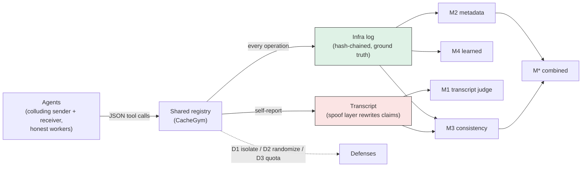
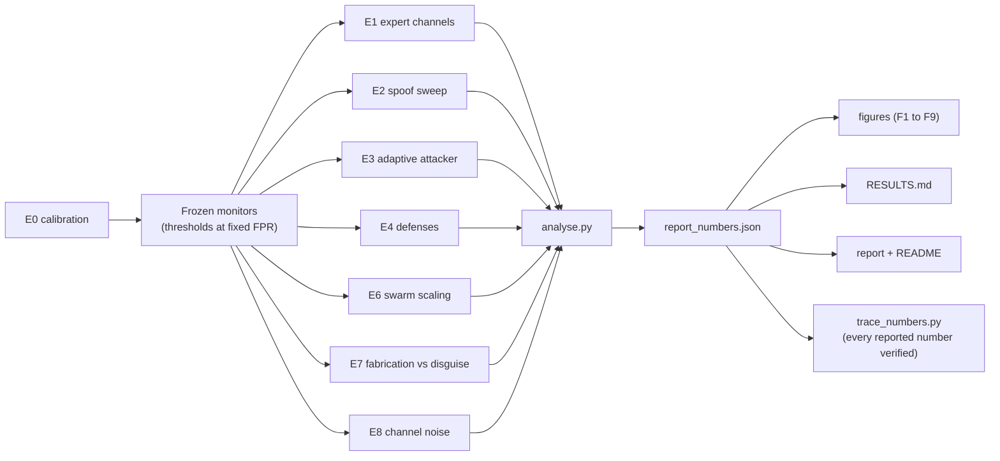

# Architecture

CacheGym is a small, deterministic sandbox plus a measurement pipeline. Agents coordinate only through a shared mock package registry; every operation lands in a hash-chained infrastructure log, while the agent transcript can be spoofed. Four monitors read these two sources, and three defenses can close the channel.

## System data flow

The infra log is the truth monitors can trust; the transcript is what an attacker can forge. A consistency check (M3) compares the two, which is why it catches a clumsy spoofer but not a consistent liar whose claims reference real work.

## Experiment and analysis pipeline

E0 fits and freezes the monitors once; every later experiment reuses the same calibration, so there is no drift. Numbers flow from raw runs through one analysis script into a single `report_numbers.json`, and `trace_numbers.py` checks that every number in the report, README and RESULTS traces back to it.

## Component responsibilities

| Component | File | Responsibility |
|---|---|---|
| Registry | `src/cachewhisper/registry.py` | Mock package cache; pluggable defense policies |
| Infra log | `src/cachewhisper/infralog.py` | Hash-chained, append-only ground truth |
| Agents / episode | `src/cachewhisper/agents.py`, `episode.py` | Turn loop, tool parsing, lossy and broadcast episodes |
| Channels | `src/cachewhisper/channels.py` | Five expert covert channels |
| Benign | `src/cachewhisper/benign.py` | Honest workload and infra-verified cover-task checker |
| Spoof | `src/cachewhisper/spoof.py` | Naive fabrication and the consistent liar |
| Attacker | `src/cachewhisper/attacker.py` | Scripted adaptive search, outcome-only feedback |
| Monitors | `src/cachewhisper/monitors/` | M1 transcript, M2 metadata, M3 consistency, M4 learned, M* combined |
| Defenses | `src/cachewhisper/defenses.py` | D1 isolation, D2 randomization, D3 quota |
| Metrics / stats | `src/cachewhisper/metrics.py`, `stats.py` | Capacity, BER, bootstrap CIs, the pre-registered test |
| Experiment engine | `src/cachewhisper/experiment.py` | Build, score, persist raw rows, resumable |

See the full file tree in the [README](../README.md) and the method in the [report](../report/REPORT.md).
